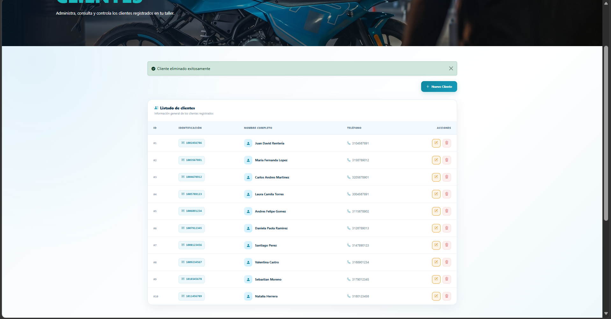
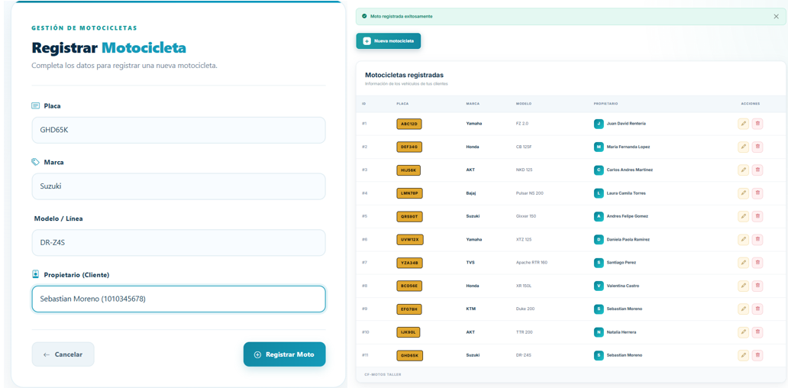
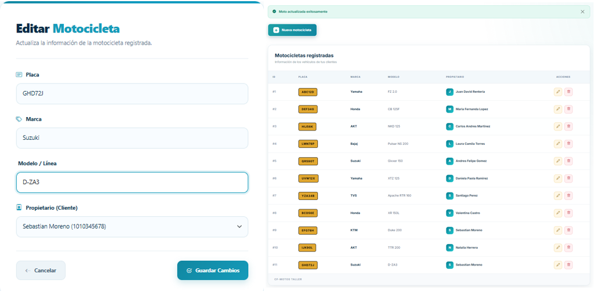
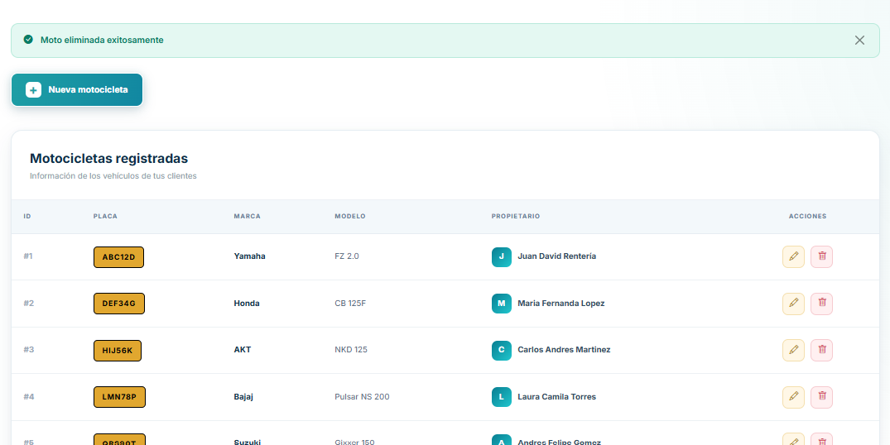
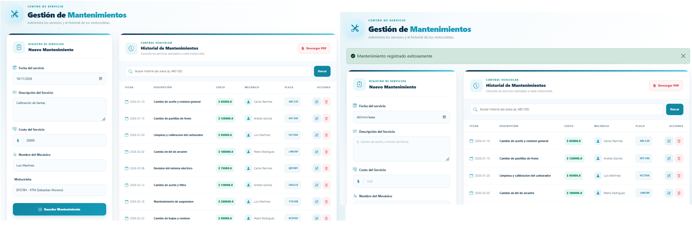
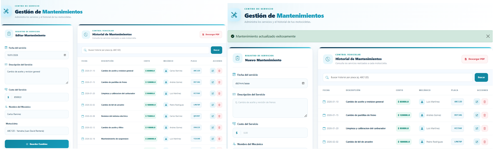
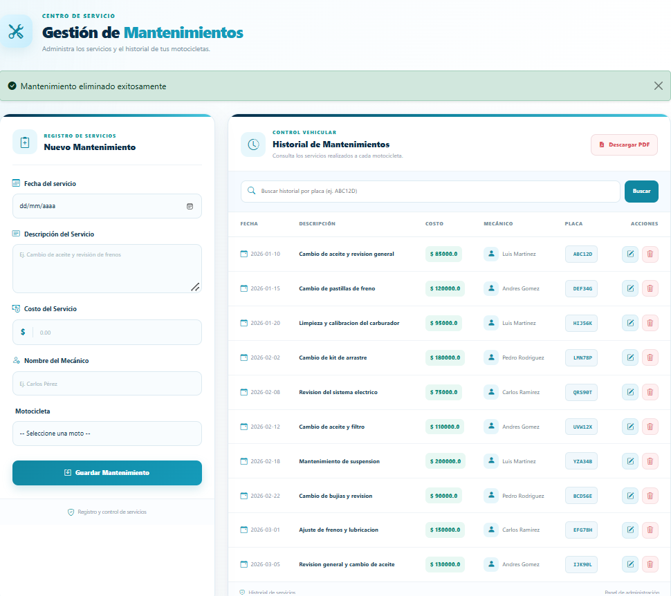
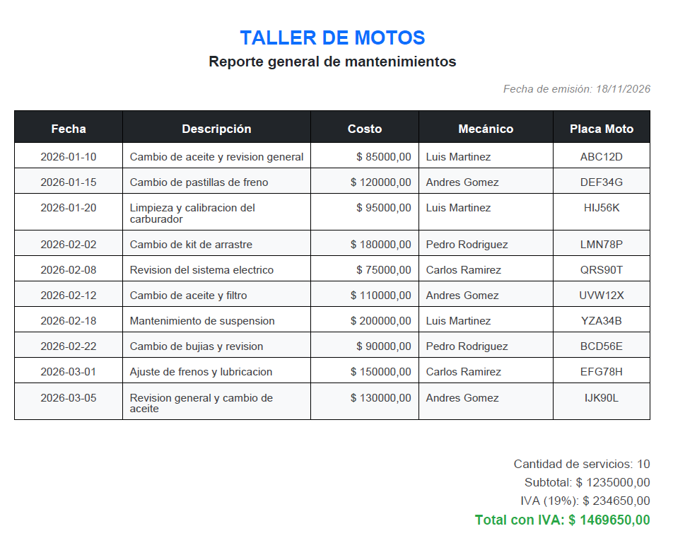

# Taller de Motos – Historial de mantenimiento

Proyecto integrador de Desarrollo Orientado a Servicios (USTA Tunja, 2026-2).
Aplicación web con **Quarkus** y **arquitectura hexagonal** que lleva el historial de mantenimiento de las motos de un taller.

## Propuesta (tres frases)

1. **Problema:** un taller de motos no lleva un historial confiable de los mantenimientos de cada vehículo; no sabe qué se le hizo a una moto, cuándo, quién lo hizo ni cuánto costó.
2. **A quién le sirve:** al administrador y a los mecánicos del taller, que registran los servicios y consultan el historial cuando llega una moto.
3. **Qué datos guarda y consulta:** clientes (propietarios), sus motocicletas y los mantenimientos de cada moto (fecha, descripción, costo y mecánico), con reporte PDF del historial.

## Requisitos

- Java 21
- XAMPP con **MySQL/MariaDB encendido** en `localhost:3306`, usuario `root` sin contraseña
- No hace falta instalar Maven: el proyecto trae el Maven Wrapper (`mvnw`)

## Cómo ejecutar

1. Encender MySQL desde el panel de XAMPP.
2. En la carpeta del proyecto ejecutar:

   Windows:
   ```
   mvnw.cmd quarkus:dev
   ```
   Linux / macOS:
   ```
   ./mvnw quarkus:dev
   ```
3. Abrir http://localhost:8080

La base `motos` y sus tablas se crean solas (`createDatabaseIfNotExist=true` y `schema-management.strategy=update`).
La primera vez, si la base está vacía, `TestDataLoader` carga datos de prueba: 4 clientes, 5 motos y 8 mantenimientos.
Para desactivarlo: `motos.seed.enabled=false` en `application.properties`.

## Pantallas y URLs

| URL | Qué hace |
| --- | --- |
| `/` | Página principal |
| `/clients` | Listado de clientes; crear, editar y eliminar |
| `/motorcycles` | Listado de motos con su propietario; crear, editar y eliminar |
| `/maintenances` | Formulario de registro/edición e historial; búsqueda por placa |
| `/maintenances?plate=KTR45F` | Historial de una sola moto |
| `/reports/maintenances/pdf` | Reporte PDF de todos los mantenimientos |
| `/reports/maintenances/pdf?plate=KTR45F` | Reporte PDF del historial de una moto |
| `/q/swagger-ui` | Documentación Swagger |
| `/q/openapi` | Documento OpenAPI |

## Modelo de datos (3 entidades relacionadas)

```
clients (1) ──< motorcycles (N) ──< maintenances (N)
   id              id                   id
   identification  plate                maintenance_date
   full_name       brand                description
   phone           model_line           cost
                   client_id (FK)       mechanic_name
                                        motorcycle_id (FK)
```

- Una moto pertenece a un cliente (`@ManyToOne` + `@JoinColumn(name = "client_id")`).
- Un mantenimiento pertenece a una moto (`@ManyToOne` + `@JoinColumn(name = "motorcycle_id")`).

## Reglas de negocio

| Regla | Dónde está |
| --- | --- |
| Identificación solo números (6–12), nombre mínimo 3 letras, teléfono 7–10 dígitos | `Client.validate()` |
| Identificación única | `ManageClientService` |
| No eliminar un cliente con motos | `ManageClientService` |
| Placa con formato colombiano `ABC12` o `ABC12D`, se guarda en mayúsculas | `Motorcycle.validate()` |
| Placa única | `ManageMotorcyclesService` |
| No eliminar una moto con mantenimientos | `ManageMotorcyclesService` |
| Fecha obligatoria y no futura, costo mayor que 0, descripción 5–500 caracteres, mecánico obligatorio | `Maintenance.validate()` |
| La moto del mantenimiento debe existir | `RegisterMaintenanceService` |
| Total con IVA (19 %) en el PDF | `MaintenanceCostCalculator` |

Cuando una regla no se cumple se lanza `BusinessRuleException` y la vista muestra el mensaje en una alerta roja.

## Arquitectura hexagonal

```
src/main/java/usta/motos
├── domain                      # Centro: sin @Entity ni código del framework
│   ├── model                   # Client, Motorcycle, Maintenance (+ validate())
│   ├── service                 # MaintenanceCostCalculator
│   └── exception               # BusinessRuleException
├── application
│   ├── port/in                 # Casos de uso: ClientUseCase, MotorcycleUseCase, MaintenanceUseCase
│   ├── port/out                # Lo que se necesita guardar/consultar: *Repository
│   └── usecase                 # Implementación de los casos de uso
└── infrastructure/adapter
    ├── in/web                  # Adaptador web: WebResource (vistas Qute), ReportResource y PdfReports
    └── out
        ├── persistence         # Adaptador JPA: entity, mapper, repository (Panache), adapter, seed
        └── inmemory            # Repositorios en memoria (solo perfil test)
```

Las dependencias apuntan hacia el dominio: los adaptadores dependen de los puertos y el dominio no depende de nadie.
La única entrada del sistema son las vistas HTML.

## Tecnologías

Quarkus 3 · Qute · Bootstrap 5 (CDN) · Hibernate ORM con Panache · MySQL · OpenPDF · SmallRye OpenAPI (Swagger) · Lombok


## Funcionalidades- Capturas
* **Inicio:**

  

### Gestión de clientes

* **Crear cliente:**

  

* **Editar cliente:**

 

* **Eliminar cliente:**

  

### Gestión de motocicletas

* **Crear moto:**

  

* **Editar moto:**

  

* **Eliminar moto:**

  

### Historial de mantenimientos y PDF

* **Crear mantenimiento:**

  

* **Editar mantenimiento:**

  

* **Eliminar mantenimiento:**

  

* **Reporte PDF:**

  


